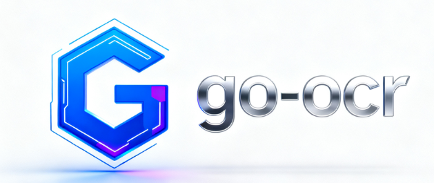
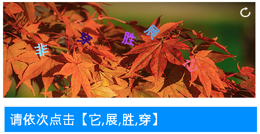

<div align="center" style="text-align: center;">
  
</div>

<p align="center">
   <a href="https://github.com/getcharzp/go-ocr/fork" target="blank">
      
   </a>
   <a href="https://github.com/getcharzp/go-ocr/stargazers" target="blank">
      
   </a>
   <a href="https://github.com/getcharzp/go-ocr/pulls" target="blank">
      
   </a>
</p>

<p align="center">
  English | <a href="./docs/README_zh.md">简体中文</a>
</p>

go-ocr is an OCR library built on Golang + ONNX, focused on providing simple, easy-to-use and extensible text recognition capabilities for the Go ecosystem.
It already integrates with PaddleOCR and DdddOCR, so you can quickly implement image text detection and recognition.

## Installation

### 1. Install the Go dependency

```shell
go get -u github.com/getcharzp/go-ocr
```

### 2. Download the models and dynamic libraries you need

Models and dynamic libraries are hosted in a separate repository (HuggingFace, with a ModelScope mirror for mainland China). **There is no need to download everything** — download only the files required by the engine you actually use.

- HuggingFace repository: https://huggingface.co/getcharzp/go-ocr
- ModelScope mirror: https://www.modelscope.cn/getcharzp/go-ocr

**Choosing the dynamic library**

Pick the onnxruntime dynamic library that matches your runtime platform:

| Platform | File |
| --- | --- |
| Linux | `lib/onnxruntime_amd64.so` |
| Windows | `lib/onnxruntime.dll` |
| macOS | `lib/onnxruntime_amd64.dylib` |

## Quick Start

### PaddleOCR

**Example code**

Calling `RunOCR()` on the engine performs full detection and recognition, while `RunDetect()` performs text region detection only.

```go
package main

import (
	ocr "github.com/getcharzp/go-ocr"
	"github.com/getcharzp/go-ocr/paddle"
	"github.com/up-zero/gotool/imageutil"
	"log"
)

func main() {
	// Configure these paths for your environment
	config := paddle.Config{
		OnnxRuntimeLibPath: "./lib/onnxruntime_amd64.so",
		DetModelPath:       "./paddle_weights/det.onnx",
		RecModelPath:       "./paddle_weights/rec.onnx",
		DictPath:           "./paddle_weights/dict.txt",
		// ThreadCount: 4, // (optional) number of parallel recognition sessions, defaults to 1
	}

	// Initialize the engine (the returned value implements the ocr.Engine interface)
	var engine ocr.Engine
	engine, err := paddle.NewEngine(config)
	if err != nil {
		log.Fatalf("failed to create OCR engine: %v\n", err)
	}
	defer engine.Destroy()

	// Open the image
	imagePath := "./test.jpg"
	img, err := imageutil.Open(imagePath)
	if err != nil {
		log.Fatalf("failed to load image: %v\n", err)
	}

	// Run OCR
	results, err := engine.RunOCR(img)
	if err != nil {
		log.Fatalf("failed to run OCR: %v\n", err)
	}
	for _, result := range results {
		log.Printf("result: %v\n", result)
	}
}
```

**Example output**

| Original image | Detection result |
|-----------------------------------------------------|----------------------------------------------------|
|  |  |


### DdddOCR

**Example code**

```go
package main

import (
	"github.com/getcharzp/go-ocr/ddddocr"
	"github.com/up-zero/gotool/imageutil"
	"image"
	"image/color"
	"image/draw"
	"log"
)

func main() {
	config := ddddocr.Config{
		OnnxRuntimeLibPath: "../lib/onnxruntime.dll",
		DetModelPath:       "../ddddocr_weights/common_det.onnx",
	}

	engine, err := ddddocr.NewEngine(config)
	if err != nil {
		log.Fatalf("failed to create OCR engine: %v\n", err)
	}
	defer engine.Destroy()

	imagePath := "./captcha_det.png"
	img, err := imageutil.Open(imagePath)
	if err != nil {
		log.Fatalf("failed to load image: %v\n", err)
	}

	boxes, err := engine.Detect(img)
	if err != nil {
		log.Fatalf("failed to run detection: %v\n", err)
	}

	tagImg := image.NewRGBA(img.Bounds())
	draw.Draw(tagImg, img.Bounds(), img, image.Point{}, draw.Src)

	for _, box := range boxes {
		imageutil.DrawThickRectOutline(tagImg, image.Rectangle{Min: image.Point{X: box.Box[0], Y: box.Box[1]},
			Max: image.Point{X: box.Box[2], Y: box.Box[3]}}, color.Black, 2)
	}
	imageutil.Save("captcha_det_result.png", tagImg, 100)
}
```

**Example output**

| Original image | Detection result |
|-------------------------------------------------------------|-------------------------------------------------------------------|
|   |  |

## License

[MIT](./LICENSE)
